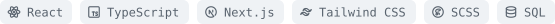

<picture><source media="(prefers-color-scheme: dark)" srcset="assets/banner-dark.svg?v=5"></picture>

<H3>Hey there 👋🏻</H3>

I’m Diogo, a Frontend Software Engineer based in Berlin, with 4+ years of experience.

Here, you can find some of the personal projects and contributions that excite me the most:  
Frontend AI Integrations, UI experiments, and other stuff.
 

<H4>Latest: Lime</H4>

A chat client for self-hosted LLMs.

  <a href="https://lime-zeta-three.vercel.app"><picture><source media="(prefers-color-scheme: dark)" srcset="assets/demo-dark.svg"></picture></a>&nbsp;
  <a href="https://github.com/classiccosta/lime-local-ai"><picture><source media="(prefers-color-scheme: dark)" srcset="assets/repo-dark.svg"></picture></a>

<!-- OSS:START -->
<!-- OSS:END -->

<H4>Stack</H4>

<picture><source media="(prefers-color-scheme: dark)" srcset="assets/stack-dark.svg"></picture>

<H4>Fun facts</H4>

If I'm not coding, I'm at the tennis court 🎾

<H4>Contacts</H4>

  <a href="mailto:cc.diogo@gmail.com"><picture><source media="(prefers-color-scheme: dark)" srcset="assets/email-dark.svg"></picture></a>&nbsp;
  <a href="https://www.linkedin.com/in/classiccosta"><picture><source media="(prefers-color-scheme: dark)" srcset="assets/linkedin-dark.svg"></picture></a>

