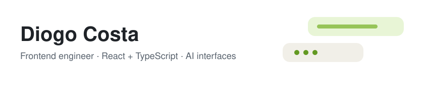

<picture>
  <source media="(prefers-color-scheme: dark)" srcset="banner-dark.svg">
  
</picture>

<H3>Hey there 👋🏻</H3>

I’m Diogo, a Frontend Software Engineer based in Berlin, with 4+ years of experience.

Here, you can find some of the personal projects and contributions that excite me the most:  
Frontend AI Integrations, UI experiments, and other stuff.
 

<H4>Latest: Lime</H4>

A chat client for self-hosted LLMs. <a href="https://lime-zeta-three.vercel.app"><b>Live demo</b></a> · <a href="https://github.com/classiccosta/lime-local-ai">Repo</a>

<H4>Fun facts</H4>

If I'm not coding, I'm at the tennis court 🎾

<H4>Contacts</H4>
📨 <a href="mailto:cc.diogo@gmail.com">cc.diogo@gmail.com</a> 
💼 <a href="https://www.linkedin.com/in/classiccosta">linkedin.com/in/classiccosta</a>

<H4>Stack</H4>

  &nbsp;&nbsp;
  &nbsp;&nbsp;
  &nbsp;&nbsp;
  &nbsp;&nbsp;
  &nbsp;&nbsp;
  

